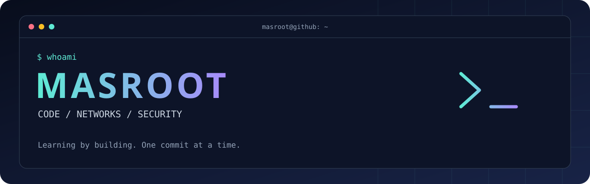

# سلام، من محمد علی‌ام 👋
### از کنجکاوی تا کد؛ از ایده تا محصول.

هنرجوی شبکه و نرم‌افزار رایانه؛ علاقه‌مند به برنامه‌نویسی، امنیت و ساخت ابزارهایی که واقعاً به کار می‌آیند.

---

## 🧑‍💻 پشت این پروفایل

یاد می‌گیرم، می‌سازم و تجربه‌هایم را به اشتراک می‌گذارم. تمرکزم روی تقویت برنامه‌نویسی، شناخت شبکه‌ها و ساخت پروژه‌های واقعی است.

- 🎓 هنرجوی **شبکه و نرم‌افزار رایانه**
- 🛠️ علاقه‌مند به ابزارهای آموزشی و تجربه‌های تعاملی
- 🐧 کار با محیط‌های **Ubuntu، Kali Linux و ماشین‌های مجازی**
- 🔎 علاقه‌مند به مباحث **Network+ و CEH** و ابزارهای تحلیل شبکه
- 🤝 مشتاق یادگیری گروهی و همکاری در پروژه‌های دانش‌آموزی

## ⚡ Toolbox

**Languages & Web**

**Systems & Security**

## 🚀 پروژهٔ شاخص · کنکور یار

### [یادگیری با کمی هیجان بیشتر ↗](https://github.com/masroot/konkoor-yar)

اپ فارسی و بازی‌وار برای جمع‌بندی کنکور رشتهٔ شبکه و نرم‌افزار؛ با درس‌نامه، آزمون زمان‌دار، نمرهٔ منفی، دفترچهٔ اشتباهات و مربی روزانه.

**وضعیت:** در حال توسعه 🟣

[مشاهدهٔ کد و پروژه](https://github.com/masroot/konkoor-yar)

## 🎯 مسیر یادگیری

**برنامه‌نویسی کاربردی** ← ساخت ابزارهای کوچک و قابل استفاده  
**شبکه و امنیت** ← تمرین در محیط آزمایشگاهی  
**توسعهٔ محصول** ← بهترکردن مرحله‌به‌مرحلهٔ کنکور یار

---

**LEARN → BUILD → SHARE → REPEAT**

«هر روز یک قدم کوچک؛ آخرش یک پروژهٔ بزرگ.»

[همهٔ پروژه‌ها ↗](https://github.com/masroot?tab=repositories)

